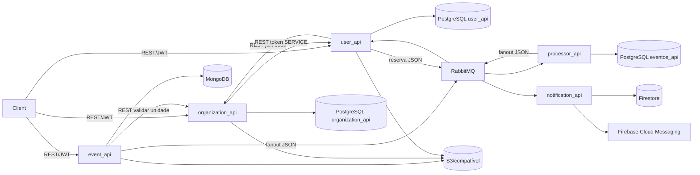
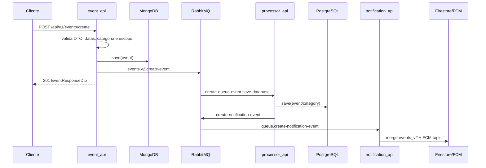
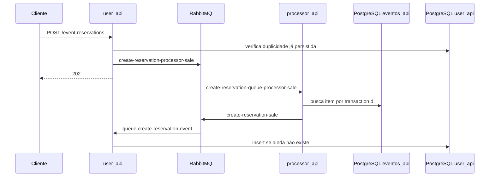

# Diagramas

```yaml
document_id: QAK-ARCH-004
service: all
document_type: diagrams
related_endpoints: [EP-EVT-002, EP-USR-021, EP-ORG-005]
related_business_rules: [BR-MSG-001, BR-RES-001, BR-ORG-001]
source_files: [event_api/src/main/java, processor_api/src/main/java, notification_api/src/main/java, user_api/src/main/java, organization_api/src/main/java]
last_analyzed: 2026-11-09
confidence: high
```

## Arquitetura confirmada



## Criação de evento



## Reserva



Fluxos não verificados: entrega efetiva em ambiente, assinatura Android nos tópicos, política de redelivery do broker além de `default-requeue-rejected=false`, e recuperação após falha entre persistência e publicação.

